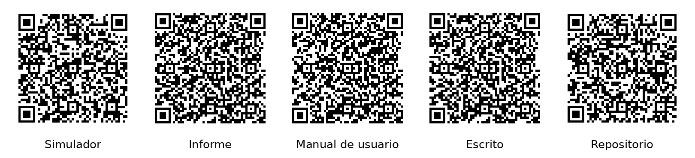
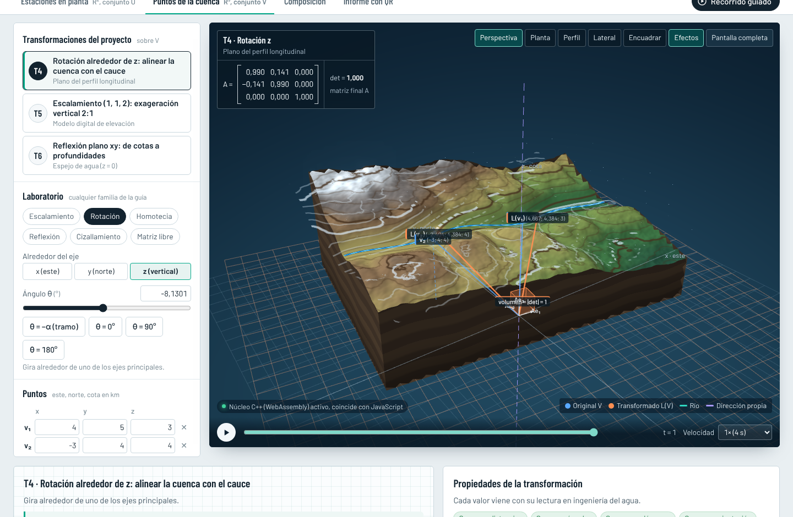

# Transformaciones lineales en R² y R³ aplicadas a la ingeniería del agua

Simulador web 3D del proyecto de **Álgebra Lineal Aplicada** del Programa de Ingeniería del Agua (Universidad de Santa Marta, 2026). Aplica escalamiento, rotación, homotecia, reflexión y cizallamiento a dos estaciones hidrométricas en planta (conjunto **U**) y a dos puntos de una cuenca con su cota (conjunto **V**), muestra cada matriz con su desarrollo paso a paso y explica qué conserva y qué modifica cada transformación en términos de ingeniería del agua.

| | Enlace |
|---|---|
| Simulador | https://apandrespenaloza.github.io/PROYECTOS_DE_ALGEBRA_LINEAL_Programa_de-Ingenieria_del_Agua_y_Desarrollo_Sostenible/ |
| Informe del proyecto (APA 7) | https://apandrespenaloza.github.io/PROYECTOS_DE_ALGEBRA_LINEAL_Programa_de-Ingenieria_del_Agua_y_Desarrollo_Sostenible/informe.html |
| Manual de usuario | https://apandrespenaloza.github.io/PROYECTOS_DE_ALGEBRA_LINEAL_Programa_de-Ingenieria_del_Agua_y_Desarrollo_Sostenible/manual.html |
| Escrito: importancia de las transformaciones lineales | https://apandrespenaloza.github.io/PROYECTOS_DE_ALGEBRA_LINEAL_Programa_de-Ingenieria_del_Agua_y_Desarrollo_Sostenible/escrito.html |





## Las seis transformaciones del proyecto

El tramo de río entre las estaciones tiene la dirección u₁ − u₂ = (7, 1), es decir α = arctan(1/7) ≈ 8,13°. Ese ángulo, deducido de los datos de la guía, alinea los ejes con el cauce.

| Clave | Espacio | Transformación | Lectura en ingeniería del agua | det |
|---|---|---|---|---|
| T1 | R², U | Rotación −α | Coordenadas del cauce (s, n): ambas estaciones quedan con n = 4,3841 km y Δs = 7,0711 km es la longitud del tramo | 1 |
| T2 | R², U | Homotecia k = 2 | Plano a escala 1:50 000: longitudes ×2, áreas ×4 | 4 |
| T3 | R², U | Cizallamiento en x, k = 0,4 | Flujo cortante: el área se conserva y la orilla no se mueve | 1 |
| T4 | R³, V | Rotación alrededor de z, θ = −α | Los dos puntos quedan en el plano del perfil longitudinal | 1 |
| T5 | R³, V | Escalamiento (1, 1, 2) | Exageración vertical 2:1: la pendiente dibujada se duplica | 2 |
| T6 | R³, V | Reflexión respecto al plano xy | De cotas a profundidades; invierte la orientación | −1 |

El módulo **Composición** analiza seis composiciones (C1–C6): por ejemplo, C·R ≠ R·C en R², mientras que las tres transformaciones de R³ conmutan.

## Qué incluye

- **Motor gráfico** (`js/grafico/`): escena three.js con un modelo digital de elevación cuya red de drenaje pasa exactamente por las estaciones, colores hipsométricos y curvas de nivel calculados en sombreadores GLSL, y la matriz aplicada en la GPU a todo el mundo (las normales se transforman con la inversa transpuesta). Rejilla y retícula deformables, cuadrado y cubo unitarios (|det A|), columnas de A, direcciones propias, trayectorias, resplandor y antialiasing.
- **Motor de ecuaciones** (`js/ecuaciones/`): álgebra 2×2 y 3×3 (determinante, inversa, autovalores reales y complejos, autovectores, valores singulares, número de condición), las familias de la guía con su forma simbólica y su interpretación, y la generación de LaTeX que compone KaTeX.
- **Núcleo C++** (`cpp/`): el mismo cálculo en C++17 sin dependencias (seno y coseno propios con los polinomios de fdlibm), compilado como programa nativo y a **WebAssembly** (`wasm/`). El simulador calcula los resultados oficiales con C++ y los comprueba con JavaScript.
- **Python** (`python/`): un script por transformación (los archivos `.py` que pide la guía), el análisis de composición, las figuras y la validación cruzada de los tres motores.
- **Interfaz** (`index.html`, `css/`, `js/app/`): módulos R², R³ y composición; laboratorio con todas las familias; cajetín con la matriz en vivo; línea de tiempo con **control de velocidad** (0,25×, 0,5×, 1× o 2×; a 1× cada animación dura 4 s); exportación CSV y JSON; **Informe con QR**; enlaces reproducibles; **recorrido guiado** a pantalla completa para grabar el video del proyecto.
- **Documentos**: informe en normas APA 7 (HTML, Word y PDF), manual de usuario (HTML y PDF), escrito argumentativo (HTML, Word y PDF) y un video de apoyo con el recorrido guiado (`documentos/video_recorrido.mp4`).

## Validación

| Nivel | Comprobaciones | Resultado |
|---|---|---|
| Pruebas unitarias del núcleo C++ (`make pruebas`) | 353 | todas correctas; seno y coseno con error ≤ 1,1·10⁻¹⁶ |
| Motores JavaScript y WebAssembly en Node (`node pruebas/motores.test.js`) | 44 | todas correctas |
| Validación cruzada Python – C++ – JavaScript (`python python/validacion_cruzada.py`) | 12 casos | mayor diferencia 1,8·10⁻¹⁵ |
| `validar()` al abrir el simulador | 24 | todas correctas |

## Uso

**En línea:** abra el enlace del simulador. No requiere instalación.

**Sin conexión:** descargue el repositorio (**Code → Download ZIP**), descomprímalo y abra `index.html`. Las bibliotecas, las fuentes y el núcleo WebAssembly (incrustado en `js/wasm/motor-wasm-datos.js`) están incluidos.

**Scripts de Python** (Python 3.10+):

```bash
pip install -r python/requirements.txt
cd python
python T1_rotacion_cauce.py          # T1; también --alfa 30
python T5_exageracion_vertical.py    # T5; también --sz 3
python composicion.py                # C1–C6
python generar_todo.py               # todo, incluida la validación cruzada
```

**Núcleo C++:**

```bash
cd cpp
make            # programa nativo y datos/resultados_cpp.json
make pruebas    # pruebas unitarias
make wasm       # WebAssembly (clang con destino wasm32)
```

**Documentos:** `node documentos/fuente/compilar.js` regenera `informe.html`, `manual.html`, `escrito.html` y los archivos Word a partir de una sola fuente (requiere los paquetes de npm `docx` y `katex`).

## Archivos

| Carpeta o archivo | Contenido |
|---|---|
| `index.html` | Simulador |
| `informe.html`, `manual.html`, `escrito.html` | Documentos en versión web |
| `css/` | Estilos del simulador y de los documentos |
| `js/ecuaciones/` | Motor de ecuaciones: `algebra.js`, `catalogo.js`, `latex.js`, `analisis.js`, `referencia.js` |
| `js/grafico/` | Motor gráfico: `terreno.js`, `shaders.js`, `escena.js`, `animador.js` |
| `js/wasm/` | Puente con el núcleo C++ y el módulo WebAssembly en base64 |
| `js/app/` | Interfaz: estado y enlaces, módulos, informe con QR, recorrido guiado, validación |
| `cpp/` | Núcleo C++ (`algebra_lineal.hpp`, `mate.hpp`), programa nativo, pruebas, interfaz WebAssembly y `Makefile` |
| `wasm/` | `motor_transformaciones.wasm` |
| `python/` | Scripts T1–T6, composición, referencia, validación cruzada |
| `datos/` | Resultados de referencia (Python) y de cada motor, y la validación cruzada |
| `pruebas/` | Pruebas de los motores en Node |
| `documentos/` | Informe y escrito en Word y PDF, manual en PDF, video de apoyo y fuente de los documentos |
| `img/` | Figuras de Python, capturas del simulador y códigos QR |
| `lib/` | three.js r128, KaTeX 0.19.1, qrcode-generator 1.4.4 y fuentes (ver `lib/LICENCIAS.md`) |

## Publicar una copia propia

1. Haga un *fork* del repositorio.
2. En **Settings → Pages** elija **Deploy from a branch**, rama `main`, carpeta `/ (root)`.
3. El sitio quedará en `https://<usuario>.github.io/<repositorio>/`. Los QR que genere el simulador usan esa dirección automáticamente.

## Privacidad

Todos los cálculos y los informes se generan en el navegador; el sitio no tiene servidor ni base de datos. El código QR contiene solo la dirección y los valores numéricos de la simulación.

## Autores

- Andrés Mauricio Peñaloza Fernández
- Eliana Carolina María Wong Lubo

Profesor principal: PhD Ellery G. Chacuto López (Álgebra Lineal Aplicada). Profesores: Luis Mario Duarte (Álgebra y Geometría Analítica); Ing. Jaris González e Ing. David De León (Introducción a las Ciencias del Agua y a la Tecnología).

## Cómo citar

Peñaloza Fernández, A. M. y Wong Lubo, E. C. M. (2026). *Transformaciones lineales en R² y R³ aplicadas a la ingeniería del agua: simulador 3D* (Versión 1.0) [Software]. GitHub. https://apandrespenaloza.github.io/PROYECTOS_DE_ALGEBRA_LINEAL_Programa_de-Ingenieria_del_Agua_y_Desarrollo_Sostenible/

Guía del proyecto: Chacuto López, E. G. (2026). *Proyectos de álgebra lineal: Programa de Ingeniería del Agua*. Universidad de Santa Marta.

«QR Code» es una marca registrada de DENSO WAVE INCORPORATED.
